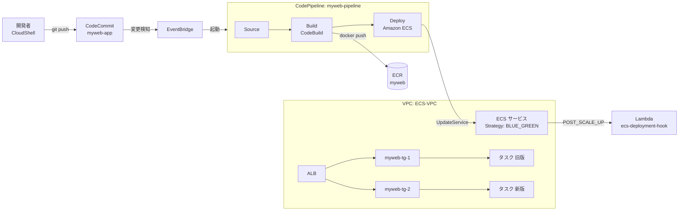
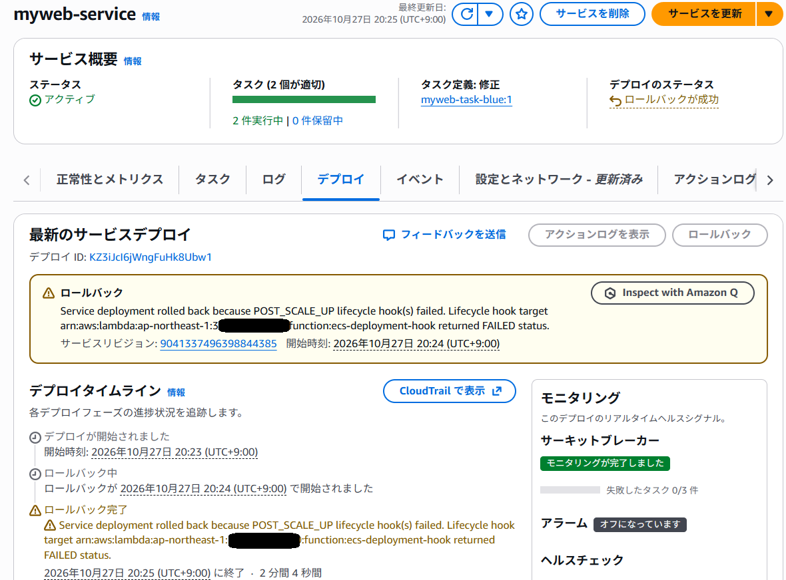

# AWS CodePipeline による Amazon ECS Blue/Green デプロイ ハンズオン

## 概要

このハンズオンでは、AWS CodePipeline を使って、Amazon ECS 組み込みの Blue/Green デプロイ（CodeDeploy を使用しない方式）を自動化します。

CodeCommit に push すると、パイプラインが次の処理を自動で実行します。

1. **Source**: CodeCommit の `main` ブランチからソースを取得
2. **Build**: CodeBuild で Docker イメージをビルドして ECR に Push し、`imagedefinitions.json` を出力
3. **Deploy**: CodePipeline の「Amazon ECS」標準デプロイアクションで ECS サービスを更新

Deploy アクションは、新しいタスク定義リビジョンを登録して ECS サービスを更新（UpdateService）します。ECS サービス側に `Strategy: BLUE_GREEN` を設定しているため、パイプライン経由のデプロイも ECS 組み込みの Blue/Green 方式で実行されます。ライフサイクルフック（Lambda）による検証と自動ロールバックもそのまま機能します。



### フォルダ構成

- **ecs-infrastructure.yaml** — VPC・ALB・ECS クラスター・ECS サービス（Blue/Green）・ライフサイクルフック用 Lambda を構築する CloudFormation テンプレート
- **app** — CodeCommit に push するアプリケーション一式
  - `Dockerfile` — nginx で `index.html` を配信するコンテナイメージ
  - `index.html` — Blue Page（背景色：青、フォント色：白）
  - `buildspec.yml` — CodeBuild のビルド定義
- **lambda** — Blue/Green デプロイ時の検証に使用する Lambda 関数のサンプルコード（テンプレートにはインラインで埋め込み済み）
- **images** — README 用の画像

### ハンズオンの流れ

| 手順 | 内容 | 作成方法 |
|------|------|----------|
| 1 | ECS 環境を構築 | CloudFormation（AWS CLI） |
| 2 | ECR リポジトリを作成 | AWS CLI |
| 3 | CodeCommit リポジトリを作成し、Blue Page を push | AWS CLI + git |
| 4 | CodeBuild プロジェクトを作成 | マネジメントコンソール |
| 5 | CodePipeline パイプラインを作成し、Blue Page をデプロイ | マネジメントコンソール |
| 6 | Lambda を FAIL にして Green Page を push し、ロールバックを確認 | AWS CLI + git |
| 7 | Lambda を SUCCESS に戻してパイプラインを再実行 | AWS CLI |

## 前提条件

- AWS マネジメントコンソールにサインインでき、AWS CloudShell を利用できること
- Amazon ECS、Amazon ECR、AWS CodePipeline、AWS CodeBuild、AWS CodeCommit、AWS Lambda、IAM、VPC 関連リソースを作成できる権限を持つ ID で AWS アカウントを使用できること

> [!NOTE]
> Docker イメージのビルドは CodeBuild が行うため、手元に Docker 環境は不要です。

> [!NOTE]
> マネジメントコンソールの画面項目の名称は、コンソールの更新により本手順の記載と異なる場合があります。

> [!IMPORTANT]
> 以降の手順は、すべて同じリージョン（例：東京リージョン `ap-northeast-1`）で実施してください。

---

## 手順 1：ECS 環境を構築する

### 1-1. CloudShell の起動と環境変数の設定

AWS マネジメントコンソールへサインインして、左下のリンクから CloudShell を起動します。
以下の環境変数を自身の環境に合わせて設定してください。

```bash
export AWS_REGION=ap-northeast-1
```

> [!NOTE]
> CloudShell のセッションが切れた場合は、環境変数を設定し直してください。

### 1-2. ハンズオン資材の取得

このフォルダを含むリポジトリを CloudShell に取得し、`ecs-codepipeline` フォルダに移動します。

```bash
git clone https://github.com/tetsuo-nobe/ecs-codepipeline.git
```

```bash
cd ecs-codepipeline/
```

> [!NOTE]
> リポジトリの URL は、資材を公開している場所に合わせて読み替えてください。

### 1-3. ECS 環境の CloudFormation スタックを作成

`ecs-infrastructure.yaml` を使って、VPC・ALB・ECS クラスター・ECS サービスを一括で作成します。
この時点では ECR にアプリのイメージがないため、ECS サービスはパブリックな nginx イメージ（`public.ecr.aws/nginx/nginx:stable`）で起動します。

```bash
aws cloudformation create-stack \
  --stack-name ecs-blue-green \
  --template-body file://ecs-infrastructure.yaml \
  --capabilities CAPABILITY_NAMED_IAM \
  --region $AWS_REGION
```

> [!NOTE]
> アカウントに `ecsTaskExecutionRole` が存在しない場合は、`--parameters ParameterKey=CreateTaskExecutionRole,ParameterValue=true` を追加してください。

### 1-4. スタック作成の完了を待機

作成完了まで数分かかります。以下のコマンドは、作成が完了するとプロンプトに戻ります。

```bash
aws cloudformation wait stack-create-complete --stack-name ecs-blue-green --region $AWS_REGION
```

> [!TIP]
> スタック作成が完了するまで待ちます。（約7～10分ほど）

### 1-5. 初期状態の確認

ALB の DNS 名を取得します。

```bash
ALB_URL=$(aws cloudformation describe-stacks --stack-name ecs-blue-green --query "Stacks[0].Outputs[?OutputKey=='ALBDNSName'].OutputValue" --output text --region $AWS_REGION)
echo $ALB_URL
```

取得した URL にブラウザでアクセスすると、nginx の初期ページ（Welcome to nginx!）が表示されます。

---

## 手順 2：ECR リポジトリを作成する（AWS CLI）

> [!NOTE]
> コマンド実行後、プロンプトに戻らない場合は q キーを押下してください。


### 2-1. ECR リポジトリの作成

CodeBuild がビルドしたイメージの格納先となる ECR リポジトリ `myweb` を作成します。

```bash
aws ecr create-repository \
  --repository-name myweb \
  --image-scanning-configuration scanOnPush=true \
  --region $AWS_REGION
```

### 2-2. リポジトリ URI の確認

リポジトリ URI を環境変数に保存して表示します。この値は手順 4 で CodeBuild の環境変数に設定するので、控えておいてください。

```bash
REPOSITORY_URI=$(aws ecr describe-repositories --repository-names myweb --query "repositories[0].repositoryUri" --output text --region $AWS_REGION)
echo $REPOSITORY_URI
```

`123456789012.dkr.ecr.ap-northeast-1.amazonaws.com/myweb` のような値が表示されます。

---

## 手順 3：CodeCommit リポジトリを作成してソースを push する

### 3-1. CodeCommit リポジトリの作成（AWS CLI）

アプリケーションのソースを格納する CodeCommit リポジトリ `myweb-app` を作成します。

```bash
aws codecommit create-repository \
  --repository-name myweb-app \
  --repository-description "ECS Blue/Green ハンズオン用" \
  --region $AWS_REGION
```

`repositoryMetadata` にリポジトリの情報（`cloneUrlHttp` など）が表示されれば作成完了です。

### 3-2. Git の設定（CloudShell）

CloudShell から CodeCommit に HTTPS で接続するために、AWS CLI の認証情報ヘルパーを設定します。

```bash
git config --global credential.helper '!aws codecommit credential-helper $@'
git config --global credential.UseHttpPath true
git config --global user.name "handson-user"
git config --global user.email "handson-user@example.com"
```

### 3-3. CodeCommit リポジトリをクローン

```bash
REPO_URL=$(aws codecommit get-repository --repository-name myweb-app --query "repositoryMetadata.cloneUrlHttp" --output text --region $AWS_REGION)
echo $REPO_URL

git clone $REPO_URL ~/myweb-app
```

空のリポジトリをクローンした旨の警告が表示されますが、問題ありません。

### 3-4. アプリケーションのファイルをコピー

`app` フォルダの内容（`Dockerfile`、`index.html`、`buildspec.yml`）をクローンしたリポジトリにコピーします。

```bash
cd ~/ecs-codepipeline
cp -r app/. ~/myweb-app/
ls -l ~/myweb-app
```

### 3-5. main ブランチに push

```bash
cd ~/myweb-app
git add .
git commit -m "Blue Page を追加"
git branch -M main
git push -u origin main
```

### 3-6. push の確認（マネジメントコンソール）

CodeCommit のコンソールで `myweb-app` リポジトリを開き、3 つのファイルが登録されていることを確認します。

---

## 手順 4：CodeBuild プロジェクトを作成する（マネジメントコンソール）

### 4-1. ビルドプロジェクトの作成を開始

1. マネジメントコンソールの検索バーで「CodeBuild」と入力し、CodeBuild のコンソールを開きます。
2. 左メニューの **［ビルドプロジェクト］** を選択し、**［プロジェクトを作成する］** を選択します。

### 4-2. プロジェクトの設定

- **プロジェクト名**: `myweb-build`

### 4-3. ソースの設定

- **ソースプロバイダ**: `AWS CodeCommit`
- **リポジトリ**: `myweb-app`
- **リファレンスタイプ**: `ブランチ`
- **ブランチ**: `main`

> [!NOTE]
> CodePipeline から実行する場合、ソースはパイプラインの Source ステージの出力が使われます。ここでの設定は、CodeBuild 単体で実行するときに使われます。

### 4-4. 環境の設定

- **コンピューティング**: `EC2`
- **プロビジョニングモデル**: `オンデマンド`
- **環境イメージ**: `マネージド型イメージ`
- **実行モード**: `コンテナ`
- **オペレーティングシステム**: `Amazon Linux`
- **ランタイム**: `Standard`
- **イメージ**: `aws/codebuild/amazonlinux-x86_64-standard:6.0`
- **サービスロール**: `新しいサービスロール`
  - **ロール名**: `codebuild-myweb-build-service-role`（自動入力された名前のままで構いません）

### 4-5. 特権モードと環境変数の設定

**［追加設定］** を展開して、以下を設定します。

- **特権付与**: 「Docker イメージを構築するか、ビルドで昇格されたアクセス権限を取得する場合は、このフラグを有効にします」に **チェックを入れる**
  - CodeBuild の中で `docker build` を実行するために必要です。
- **環境変数**: **［環境変数の追加］** で以下の 2 つを追加します。

| 名前 | 値 | タイプ |
|------|----|--------|
| `REPOSITORY_URI` | 手順 2-2 で控えたリポジトリ URI（例：`123456789012.dkr.ecr.ap-northeast-1.amazonaws.com/myweb`） | プレーンテキスト |
| `CONTAINER_NAME` | `myweb` | プレーンテキスト |

> [!NOTE]
> `CONTAINER_NAME` は、ECS タスク定義のコンテナ名と一致させる必要があります。`buildspec.yml` はこの 2 つの環境変数を使って、イメージの Push 先と `imagedefinitions.json` の内容を決めます。

### 4-6. Buildspec・アーティファクト・ログの設定

- **Buildspec**: `buildspec ファイルを使用する`（Buildspec 名は空欄のままで、リポジトリ直下の `buildspec.yml` が使われます）
- **アーティファクト**: `アーティファクトなし`（CodePipeline から実行する場合は、パイプラインのアーティファクトとして出力されます）
- **ログ**: `CloudWatch Logs` にチェックが入っていることを確認

### 4-7. プロジェクトの作成

**［ビルドプロジェクトを作成する］** を選択します。

### 4-8. CodeBuild のサービスロールに ECR への Push 権限を付与（CloudShell）

コンソールで自動作成されたサービスロールには、ECR にイメージを Push する権限が含まれていません。CloudShell で次のコマンドを実行し、AWS 管理ポリシー `AmazonEC2ContainerRegistryPowerUser` をアタッチします。

```bash
aws iam attach-role-policy \
  --role-name codebuild-myweb-build-service-role \
  --policy-arn arn:aws:iam::aws:policy/AmazonEC2ContainerRegistryPowerUser
```

アタッチされたことを確認します。

```bash
aws iam list-attached-role-policies --role-name codebuild-myweb-build-service-role
```

> [!NOTE]
> 手順 4-4 でロール名を変更した場合は、`--role-name` をその名前に読み替えてください。

### 4-9. buildspec.yml の内容を確認（CloudShell）

CodeBuild が実行するビルドの手順は、リポジトリ直下の `buildspec.yml` に書かれています。内容を表示します。

```bash
cat ~/myweb-app/buildspec.yml
```

`buildspec.yml` は、次のフェーズ（`phases`）の順にコマンドを実行します。

| フェーズ | 処理内容 |
|----------|----------|
| `pre_build` | ECR にログインし、イメージタグ（コミット ID の先頭 7 文字）を決める |
| `build` | `Dockerfile` から Docker イメージをビルドする |
| `post_build` | イメージを ECR に Push し、`imagedefinitions.json` を作成する |

最後の `artifacts` で、作成した `imagedefinitions.json` をビルドの出力（アーティファクト）として次のステージに渡します。

`imagedefinitions.json` は、デプロイするコンテナ名とイメージ URI を書いたファイルで、次のような内容になります。

```json
[{"name":"myweb","imageUri":"123456789012.dkr.ecr.ap-northeast-1.amazonaws.com/myweb:1a2b3c4"}]
```

手順 5 で作成するパイプラインの Deploy ステージは、このファイルを読み込みます。そして、タスク定義のコンテナ `myweb` のイメージを差し替えて、ECS サービスを更新します。

> [!NOTE]
> `buildspec.yml` の中の `$REPOSITORY_URI` と `$CONTAINER_NAME` には、手順 4-5 で設定した環境変数の値が入ります。

---

## 手順 5：CodePipeline パイプラインを作成する（マネジメントコンソール）

パイプラインは作成直後に自動で 1 回実行されます。手順 3 で Blue Page を push 済みのため、この初回実行で Blue Page がデプロイされます。

> [!IMPORTANT]
> 手順 1 の CloudFormation スタックの作成が完了（`CREATE_COMPLETE`）していることを確認してから進めてください。

### 5-1. パイプラインの作成を開始

1. マネジメントコンソールの検索バーで「CodePipeline」と入力し、CodePipeline のコンソールを開きます。
2. **［パイプラインを作成する］** を選択します。

### 5-2. 作成オプションの選択

- **カテゴリ**: `カスタムパイプラインを構築する` を選択し、**［次に］** を選択します。

### 5-3. パイプラインの設定

- **パイプライン名**: `myweb-pipeline`
- **実行モード**: `キュー`（既定値）
- **サービスロール**: `新しいサービスロール`
  - **ロール名**: 自動入力された名前のままで構いません
  - 「AWS CodePipeline がサービスロールを作成できるようになるため、この新しいパイプラインでの使用が可能になります。」にチェックが入っていることを確認

**［次に］** を選択します。

> [!NOTE]
> パイプラインタイプは V2 になります。アーティファクトストアは既定のロケーション（CodePipeline が自動作成する S3 バケット）を使用します。

### 5-4. ソースステージの追加

- **ソースプロバイダー**: `AWS CodeCommit`
- **リポジトリ名**: `myweb-app`
- **ブランチ名**: `main`
- **ソースの変更を自動的に検出する EventBridge ルールを作成**: `チェックする`
- **出力アーティファクト形式**: `CodePipeline のデフォルト`

**［次に］** を選択します。

> [!NOTE]
> 「ソースの変更を自動的に検出する EventBridge ルールを作成」にチェックを入れると、CodeCommit への push を検知してパイプラインを起動する EventBridge ルールが自動で作成されます。

### 5-5. ビルドステージの追加

- **プロバイダーを構築する**: `その他のビルドプロバイダー` → `AWS CodeBuild`
- **プロジェクト名**: `myweb-build`（手順 4 で作成したもの）
- **ビルドタイプ**: `単一ビルド`
- **リージョン**: 作業中のリージョン
- **入力アーティファクト**: `SourceArtifact` （既定値）


**［次に］** を選択します。

### 5-6. テストステージ

**［テストステージをスキップ］** を選択します。

### 5-7. デプロイステージの追加

- **デプロイプロバイダー**: `Amazon ECS`
- **リージョン**: 作業中のリージョン
- **入力アーティファクト**: `BuildArtifact`（既定値）
- **クラスター名**: `ECS-VPC`
- **サービス名**: `myweb-service`
- **イメージ定義ファイル**: `imagedefinitions.json`
- **デプロイタイムアウト**: 空欄のまま（既定値）

> [!IMPORTANT]
> **「ステージ障害時の自動ロールバックを設定」のチェックを外して** ください。
> このチェックが入っていると、Deploy ステージが失敗したときに、CodePipeline が前回成功したアーティファクト（Blue Page のイメージ）で自動的にデプロイをやり直します。手順 6 では ECS のライフサイクルフックによるロールバックだけを確認したいので、CodePipeline 側の自動ロールバックは無効にします。
>
> 自動再試行の設定が表示される場合も、同様にチェックを外してください。

**［次に］** を選択します。

> [!NOTE]
> Blue/Green デプロイは Bake Time（2分）が経過するまで完了しないため、Deploy アクションは通常のローリングデプロイより時間がかかります。デプロイタイムアウトを指定する場合は、Bake Time より十分長い値にしてください。

### 5-8. 確認と作成

設定内容を確認し、**［パイプラインを作成する］** を選択します。

### 5-9. パイプラインの実行状況を確認

パイプラインの画面で、Source → Build → Deploy の順に実行されていく様子を確認します。CloudShell からも確認できます。

```bash
aws codepipeline get-pipeline-state --name myweb-pipeline \
  --query "stageStates[].{Stage:stageName,Status:latestExecution.status}" \
  --output table --region $AWS_REGION
```

> [!TIP]
> Build ステージの **[AWS CodeBuild]** リンクを選択すると、CodeBuild のビルドログを確認できます。ECR への Push と `imagedefinitions.json` の出力内容がログに表示されます。

### 5-10. Blue/Green デプロイの進行を確認

Deploy ステージでは ECS の Blue/Green デプロイが実行されます。ECS サービスのデプロイ状況は次のコマンドで確認できます。

```bash
aws ecs describe-services --cluster ECS-VPC --services myweb-service --query "services[0].deployments" --region $AWS_REGION
```

Bake Time（2分）の間は、旧バージョン（nginx の初期ページ）と新バージョン（Blue Page）の両方のタスクが稼働しています。Bake Time 経過後に旧バージョンのタスクが終了し、Deploy ステージが `Succeeded` になります。

### 5-11. Blue Page の確認

ALB の URL にブラウザでアクセスすると、Blue Page が表示されます。

```bash
echo $ALB_URL
```


> [!NOTE]
> ECR のコンソールで `myweb` リポジトリを開くと、コミット ID の先頭 7 文字をタグにしたイメージが登録されています。

---

## 手順 6：ライフサイクルフックによるロールバックを確認する

ECS サービスには、デプロイの POST_SCALE_UP ステージで Lambda 関数を呼び出すライフサイクルフックが設定されています。
Lambda 関数の環境変数 `VALIDATION_RESULT` の値で、デプロイを続行するか（`SUCCESS`）ロールバックするか（`FAIL`）を切り替えます。

### 6-1. Lambda の環境変数を FAIL に変更

```bash
aws lambda update-function-configuration \
  --function-name ecs-deployment-hook \
  --environment "Variables={VALIDATION_RESULT=FAIL}" \
  --region $AWS_REGION
```

### 6-2. Green Page に変更

`index.html` の背景色とタイトルを Green に変更します。

```bash
cd ~/myweb-app
sed -i 's/Blue/Green/g; s/blue/green/g' index.html
cat index.html
```

### 6-3. 変更を push

```bash
git add index.html
git commit -m "Green Page に変更"
git push
```

push を EventBridge が検知し、パイプラインが自動で起動します。

### 6-4. パイプラインの失敗を確認

```bash
aws codepipeline get-pipeline-state --name myweb-pipeline \
  --query "stageStates[].{Stage:stageName,Status:latestExecution.status}" \
  --output table --region $AWS_REGION
```

Build ステージで Green Page のイメージがビルドされ、Deploy ステージで Blue/Green デプロイが開始されます。
POST_SCALE_UP ステージで Lambda が `FAILED` を返すため、ECS が自動的に Blue Page にロールバックし、パイプラインの Deploy ステージは `Failed` になります。

> [!NOTE]
> 手順 5-7 で「ステージ障害時の自動ロールバックの設定」のチェックを外し忘れた場合は、Deploy ステージの失敗後に、CodePipeline が Blue Page のイメージで自動的にデプロイし直します（パイプラインの実行履歴のトリガーに `AutomatedRollback` と表示されます）。画面は Blue Page のままなので、そのまま手順 6-5 に進んで構いません。

### 6-5. ECS のロールバックを確認

マネジメントコンソールで ECS サービスのページのデプロイタブを選択すると、ロールバックの情報を確認できます。



ロールバック後、ALB の URL にアクセスすると引き続き Blue Page が表示されます。

### 6-6. Lambda のログを確認

```bash
aws logs tail /aws/lambda/ecs-deployment-hook --since 30m --region $AWS_REGION
```

ログに「検証失敗: デプロイをロールバックします」と出力されていることを確認します。

---

## 手順 7：パイプラインを再実行して Green Page をデプロイする

### 7-1. Lambda の環境変数を SUCCESS に戻す

```bash
aws lambda update-function-configuration \
  --function-name ecs-deployment-hook \
  --environment "Variables={VALIDATION_RESULT=SUCCESS}" \
  --region $AWS_REGION
```

### 7-2. パイプラインを再実行

ソースは変更せずに、パイプラインを手動で再実行します。CodeCommit の `main` ブランチの最新のコミット（Green Page に変更したコミット）で、Source → Build → Deploy が実行されます。

```bash
aws codepipeline start-pipeline-execution --name myweb-pipeline --region $AWS_REGION
```

> [!NOTE]
> CodePipeline のコンソールで、パイプラインの **［変更をリリースする］** を選択しても同じ操作ができます。

> [!TIP]
> 失敗した Deploy ステージだけを再試行する方法（`aws codepipeline retry-stage-execution` やコンソールの **［再試行］**）もあります。ただし、CodePipeline の自動ロールバックが動いた場合は、Deploy ステージの最新の実行がロールバックの実行（Blue Page のデプロイ）に置き換わるため、Green Page のデプロイを再試行できません。パイプライン全体を再実行すれば、自動ロールバックの有無にかかわらず、最新のコミットを確実にデプロイできます。

### 7-3. デプロイの完了を確認

今度は Lambda が `SUCCEEDED` を返し、デプロイが続行されます。

```bash
aws codepipeline get-pipeline-state --name myweb-pipeline \
  --query "stageStates[].{Stage:stageName,Status:latestExecution.status}" \
  --output table --region $AWS_REGION
```

Bake Time（2分）経過後に Blue 側のタスクが終了し、Deploy ステージが `Succeeded` になります。

### 7-4. Green Page の確認

ALB の URL にアクセスすると Green Page が表示されます。


### お疲れさまでした！ AWS CodePipeline を使用し、Amazon ECS のサービスの新しいタスクを Blue/Green デプロイメントでデプロイしました。

---

## 環境のクリーンアップ

作成した順番と逆の順番で削除します。

### 8-1. パイプラインの削除（AWS CLI）

```bash
aws codepipeline delete-pipeline --name myweb-pipeline --region $AWS_REGION
```

削除できたことを確認します。一覧に `myweb-pipeline` が表示されなければ削除完了です。

```bash
aws codepipeline list-pipelines --query "pipelines[].name" --output text --region $AWS_REGION
```

### 8-2. CodeBuild プロジェクトの削除（AWS CLI）

```bash
aws codebuild delete-project --name myweb-build --region $AWS_REGION
```

削除できたことを確認します。一覧に `myweb-build` が表示されなければ削除完了です。

```bash
aws codebuild list-projects --query "projects" --output text --region $AWS_REGION
```

### 8-3. CodeCommit リポジトリの削除（AWS CLI）

```bash
aws codecommit delete-repository --repository-name myweb-app --region $AWS_REGION
```

削除されたリポジトリの ID（`repositoryId`）が表示されれば削除完了です。

> [!CAUTION]
> CodeCommit リポジトリを削除すると、push したソースコードとコミット履歴は復元できません。

### 8-4. ECR リポジトリの削除（AWS CLI）

```bash
aws ecr delete-repository --repository-name myweb --force --region $AWS_REGION
```

### 8-5. ECS 環境のスタックを削除

```bash
aws cloudformation delete-stack --stack-name ecs-blue-green --region $AWS_REGION
aws cloudformation wait stack-delete-complete --stack-name ecs-blue-green --region $AWS_REGION
```

### 8-6. タスク定義の登録解除

CodePipeline が登録したタスク定義のリビジョン（`myweb-task`）は、スタックを削除しても残ります。すべてのリビジョンを登録解除します。

```bash
for arn in $(aws ecs list-task-definitions --family-prefix myweb-task --status ACTIVE --query "taskDefinitionArns[]" --output text --region $AWS_REGION); do
  echo "登録解除: $arn"
  aws ecs deregister-task-definition --task-definition $arn --region $AWS_REGION > /dev/null
done
```

ACTIVE なリビジョンが残っていないことを確認します。何も表示されなければ完了です。

```bash
aws ecs list-task-definitions --family-prefix myweb-task --status ACTIVE --query "taskDefinitionArns[]" --output text --region $AWS_REGION
```

### 8-7. コンソールで自動作成されたリソースの削除（AWS CLI）

手順 4・手順 5 でコンソールから作成したときに、以下のリソースが自動で作成されています。AWS CLI で順番に削除します。

| リソース | 名前の例 |
|----------|----------|
| EventBridge ルール | `codepipeline-myweb-a-main-xxxxxx-rule` |
| IAM ロール（CodePipeline） | `AWSCodePipelineServiceRole-ap-northeast-1-myweb-pipeline` |
| IAM ロール（CodeBuild） | `codebuild-myweb-build-service-role` |
| IAM ロール（EventBridge） | `cwe-role-ap-northeast-1-myweb-pipeline` |
| IAM ポリシー（上記ロールにアタッチ） | `CodeBuildBasePolicy-myweb-build-ap-northeast-1` など |
| CloudWatch Logs ロググループ | `/aws/codebuild/myweb-build` |
| S3 バケット（アーティファクトストア） | `codepipeline-ap-northeast-1-xxxxxxxx` |

#### 8-7-1. EventBridge ルールの削除

パイプラインを起動するルールを、ターゲット（パイプラインの ARN）から探します。

```bash
AWS_ACCOUNT_ID=$(aws sts get-caller-identity --query Account --output text)
PIPELINE_ARN=arn:aws:codepipeline:$AWS_REGION:$AWS_ACCOUNT_ID:myweb-pipeline

RULE_NAMES=$(aws events list-rule-names-by-target --target-arn $PIPELINE_ARN --query "RuleNames[]" --output text --region $AWS_REGION)
echo $RULE_NAMES
```

`codepipeline-myweb-a-main-xxxxxx-rule` のようなルール名が表示されます。ルールはターゲットを外してから削除します。

```bash
for rule in $RULE_NAMES; do
  TARGET_IDS=$(aws events list-targets-by-rule --rule $rule --query "Targets[].Id" --output text --region $AWS_REGION)
  aws events remove-targets --rule $rule --ids $TARGET_IDS --region $AWS_REGION
  aws events delete-rule --name $rule --region $AWS_REGION
  echo "削除: $rule"
done
```

#### 8-7-2. IAM ロールの確認

ハンズオンで自動作成された IAM ロールを、名前で絞り込んで確認します。

```bash
ROLE_NAMES=$(aws iam list-roles --query "Roles[?contains(RoleName,'myweb-pipeline') || contains(RoleName,'myweb-build')].RoleName" --output text)
echo $ROLE_NAMES
```

CodePipeline・CodeBuild・EventBridge 用の 3 つのロールが表示されることを確認します。

> [!CAUTION]
> ハンズオン以外のロールが表示された場合は、次の手順に進まず、`ROLE_NAMES` に削除するロール名だけを設定し直してください（例：`ROLE_NAMES="ロール名1 ロール名2"`）。

#### 8-7-3. IAM ロールとポリシーの削除

IAM ロールは、アタッチされたポリシーとインラインポリシーを外してから削除します。
コンソールが作成したカスタマー管理ポリシー（`CodeBuildBasePolicy-...` など）は、ロールから外したあとに削除します。AWS 管理ポリシー（手順 4-8 でアタッチした `AmazonEC2ContainerRegistryPowerUser` など）は外すだけで、削除はしません。

```bash
for role in $ROLE_NAMES; do
  # アタッチされている管理ポリシーを外す
  for policy_arn in $(aws iam list-attached-role-policies --role-name $role --query "AttachedPolicies[].PolicyArn" --output text); do
    aws iam detach-role-policy --role-name $role --policy-arn $policy_arn
    # カスタマー管理ポリシー（自アカウントのポリシー）は、ほかで使われていなければ削除する
    if [[ $policy_arn == arn:aws:iam::$AWS_ACCOUNT_ID:* ]]; then
      ATTACHMENT_COUNT=$(aws iam get-policy --policy-arn $policy_arn --query "Policy.AttachmentCount" --output text)
      if [ "$ATTACHMENT_COUNT" = "0" ]; then
        # デフォルト以外のバージョンを削除してからポリシーを削除する
        for v in $(aws iam list-policy-versions --policy-arn $policy_arn --query "Versions[?IsDefaultVersion==\`false\`].VersionId" --output text); do
          aws iam delete-policy-version --policy-arn $policy_arn --version-id $v
        done
        aws iam delete-policy --policy-arn $policy_arn
        echo "ポリシー削除: $policy_arn"
      fi
    fi
  done
  # インラインポリシーを削除する
  for policy_name in $(aws iam list-role-policies --role-name $role --query "PolicyNames[]" --output text); do
    aws iam delete-role-policy --role-name $role --policy-name $policy_name
  done
  # ロールを削除する
  aws iam delete-role --role-name $role
  echo "ロール削除: $role"
done
```

ロールが残っていないことを確認します。何も表示されなければ完了です。

```bash
aws iam list-roles --query "Roles[?contains(RoleName,'myweb-pipeline') || contains(RoleName,'myweb-build')].RoleName" --output text
```

#### 8-7-4. CodeBuild のロググループの削除

```bash
aws logs delete-log-group --log-group-name /aws/codebuild/myweb-build --region $AWS_REGION
```

#### 8-7-5. アーティファクトストアの S3 バケットの確認

CodePipeline が自動作成した S3 バケットを探し、中身を確認します。

```bash
BUCKET=$(aws s3api list-buckets --query "Buckets[?starts_with(Name,'codepipeline-$AWS_REGION-')].Name" --output text)
echo $BUCKET

aws s3 ls s3://$BUCKET/
```

バケット直下には、パイプラインごとのフォルダ（このハンズオンでは `myweb-pipeline/`）が表示されます。

> [!CAUTION]
> アーティファクトストアの S3 バケットは、同じリージョンのほかのパイプラインと共用されています。`myweb-pipeline/` 以外のフォルダが表示された場合は、バケットを削除せず、次の 8-7-6 で `myweb-pipeline/` フォルダだけを削除してください。
> また、`echo $BUCKET` で複数のバケット名が表示された場合は、`BUCKET=バケット名` で削除するバケットを 1 つ設定し直してください。

#### 8-7-6. アーティファクトストアの S3 バケットの削除

`myweb-pipeline/` フォルダしかない場合は、バケットごと削除します。

```bash
aws s3 rb s3://$BUCKET --force
```

ほかのパイプラインのフォルダもある場合は、`myweb-pipeline/` フォルダだけを削除します。

```bash
aws s3 rm s3://$BUCKET/myweb-pipeline/ --recursive
```

> [!NOTE]
> バケットでバージョニングが有効になっている場合、`aws s3 rb --force` が `BucketNotEmpty` エラーで失敗することがあります。その場合は、S3 コンソールでバケットを選択して **［空にする］** を実行してから、再度 `aws s3 rb s3://$BUCKET` を実行してください。

### 8-8. CloudShell 上のファイルの削除（任意）

```bash
rm -rf ~/myweb-app ~/ecs-codepipeline
```

---

## 補足

- **タスク定義のリビジョン管理**: CodePipeline の ECS 標準デプロイアクションは、ECS サービスが使用中のタスク定義リビジョンをもとに、イメージ URI だけを差し替えた新しいリビジョンを登録します。パイプライン運用開始後に `ecs-infrastructure.yaml` のスタックを更新すると、サービスが初期リビジョン（nginx）に戻る可能性があるため注意してください。
- **CodePipeline のサービスロール**: Deploy ステージが権限エラーで失敗する場合は、CodePipeline のサービスロールに `ecs:RegisterTaskDefinition`・`ecs:UpdateService`・`ecs:DescribeServices` などの ECS 権限と、`ecsTaskExecutionRole` に対する `iam:PassRole` 権限があるか確認してください。
- **イメージタグ**: `buildspec.yml` ではコミット ID の先頭 7 文字をイメージタグに使用しています。どのコミットがデプロイされたかを ECR のタグから追跡できます。

## 参考ドキュメント

- [Amazon ECS blue/green deployments](https://docs.aws.amazon.com/AmazonECS/latest/developerguide/deployment-type-blue-green.html) — ECS 組み込み Blue/Green デプロイの概要
- [Amazon ECS blue/green service deployments workflow](https://docs.aws.amazon.com/AmazonECS/latest/developerguide/blue-green-deployment-how-it-works.html) — デプロイのライフサイクルとワークフロー
- [Lifecycle hooks for Amazon ECS service deployments](https://docs.aws.amazon.com/AmazonECS/latest/developerguide/deployment-lifecycle-hooks.html) — ライフサイクルフックの実装と hookStatus の仕様
- [Amazon Elastic Container Service deploy action reference](https://docs.aws.amazon.com/codepipeline/latest/userguide/action-reference-ECS.html) — CodePipeline の ECS 標準デプロイアクション
- [imagedefinitions.json file for Amazon ECS standard deployment actions](https://docs.aws.amazon.com/codepipeline/latest/userguide/file-reference.html) — imagedefinitions.json の仕様
- [Tutorial: Amazon ECS Standard Deployment with CodePipeline](https://docs.aws.amazon.com/codepipeline/latest/userguide/ecs-cd-pipeline.html) — CodePipeline による ECS デプロイのチュートリアル
- [Create a pipeline in CodePipeline (console)](https://docs.aws.amazon.com/codepipeline/latest/userguide/pipelines-create.html) — コンソールでのパイプライン作成手順
- [Create a build project (console)](https://docs.aws.amazon.com/codebuild/latest/userguide/create-project-console.html) — コンソールでの CodeBuild プロジェクト作成手順
- [Migrate CodeDeploy blue/green deployments to Amazon ECS blue/green deployments](https://docs.aws.amazon.com/AmazonECS/latest/developerguide/migrate-codedeploy-to-ecs-bluegreen.html) — CI/CD から UpdateService を使う方式への移行

---

## 講師用：環境のクリーンアップを一括で行う

`cleanup.sh` を実行すると、「環境のクリーンアップ」（手順 8-1〜8-8）の内容をまとめて実行できます。

### 削除されるリソース

- パイプラインを起動する EventBridge ルール
- CodePipeline パイプライン `myweb-pipeline`
- CodeBuild プロジェクト `myweb-build`
- CodeCommit リポジトリ `myweb-app`
- ECR リポジトリ `myweb`（イメージを含む）
- CloudFormation スタック `ecs-blue-green`（VPC・ALB・ECS クラスター/サービス・Lambda・IAM ロールなど）
- タスク定義 `myweb-task` の ACTIVE なリビジョン
- コンソールで自動作成された IAM ロールとポリシー（ロール名に `myweb-pipeline` または `myweb-build` を含むもの）
- ロググループ `/aws/codebuild/myweb-build`、`/aws/lambda/ecs-deployment-hook`
- アーティファクトストアの S3 バケット（`codepipeline-<リージョン>-*`）
- CloudShell 上の `~/myweb-app`

> [!NOTE]
> アーティファクトストアの S3 バケットにほかのパイプラインのフォルダがある場合は、バケットは削除せず、`myweb-pipeline/` フォルダだけを削除します。

### 実行手順

1. AWS マネジメントコンソールで、ハンズオンを実施したリージョンを選択して CloudShell を起動します。
2. リージョンを設定します。

   ```bash
   export AWS_REGION=ap-northeast-1
   ```

3. リポジトリを取得していない場合は、クローンします。

   ```bash
   git clone https://github.com/tetsuo-nobe/ecs-codepipeline.git
   ```

4. スクリプトを実行します。

   ```bash
   cd ~/ecs-codepipeline
   bash cleanup.sh
   ```

5. 削除対象のアカウント・リージョン・リソースが表示されます。特に **IAM ロール** と **S3 バケット** にハンズオン以外のものが含まれていないことを確認し、`yes` と入力します。
6. 最後に `[INFO] クリーンアップが完了しました` と表示されれば完了です。スタックの削除を待つため、数分かかります。

> [!NOTE]
> 存在しないリソースはスキップされるため、途中で失敗した場合や受講者が一部を削除済みの場合も、そのまま再実行できます。
> 確認を省略する場合は、`bash cleanup.sh -y` で実行します。

> [!CAUTION]
> 削除したリソースは元に戻せません。実行前に、表示されたアカウントとリージョンが正しいことを必ず確認してください。
> スクリプトは `~/myweb-app` を削除しますが、`~/ecs-codepipeline` は削除しません。不要であれば、スクリプトの実行後に `rm -rf ~/ecs-codepipeline` で削除してください。
